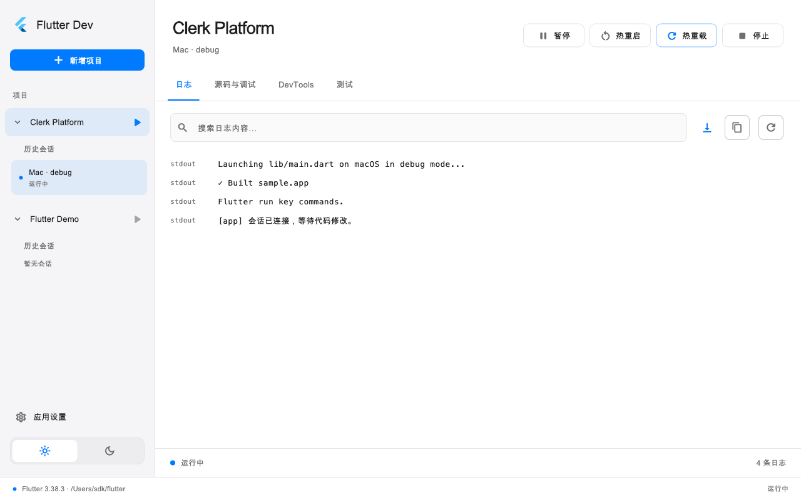

# Flutter Dev

独立的 Flutter Desktop 运行与调试工具。Flutter 展示工作台，Rust 管理 SDK、daemon、DAP、会话和有界日志。实施依据见 [技术设计](docs/technical-design.md)。

在外部编辑器中编写代码，在 Flutter Dev 中选择项目、设备和运行配置，完成启动、调试、热重载、构建和性能分析。Rust 以应用内原生库运行，由项目所选的 Flutter SDK 提供调试能力。

## 功能概览

| 功能 | 当前能力 |
| --- | --- |
| 项目与 SDK | 多包项目识别、项目列表恢复、FVM / 项目 SDK / 全局默认 SDK |
| 运行与调试 | 设备发现、模拟器入口、launch / attach、多会话、手动热重载与热重启、基础 DAP 面板 |
| 日志与源码 | 有界日志、分页搜索与复制、只读源码 |
| 网络请求 | Debug 会话 HTTP profiling、请求列表、请求头 / 参数 / 响应、JSON 展开与复制 |
| DevTools | 官方 Inspector、Performance、CPU Profiler、Memory、Logging 按会话加载 |
| 构建与外观 | 构建预设与日志、产物目录入口、浅色 / 深色、窄窗口布局 |

macOS 是当前实际验证的宿主；Windows / Linux 已有宿主工程和 CI 构建配置，仍需远端构建及实机验收。Windows 官方 DevTools 使用 WebView2，Linux 内嵌尚未实现。各项验证边界见 [兼容基线](docs/compatibility-baseline.md) 和 [验收记录](docs/validation.md)。



预览使用样例会话和本机字体，更多深色、设置、网络面板与窄窗口预览见 [设计记录](docs/design/prompts.md)。

构建窗口与应用设置采用现代简约的 Apple 风格，支持深浅色与窄窗口布局。页面和应用图标由内置 imagegen 生成参考，再使用原生 Flutter 控件实现；设计图、最终提示词与实际渲染见 [设计记录](docs/design/prompts.md)。新图标接入工作台侧栏及三个桌面宿主；源图位于 `assets/branding/app-icon-source.png`，安装 Pillow 后运行 `python3 scripts/generate_app_icons.py` 可重新导出平台图标。

当前为阶段一增量，包含 macOS / Windows / Linux 宿主与构建配置、正式 `flutter_rust_bridge` 桥接、项目包和 SDK 识别、导入项目持久化、设备与模拟器入口、运行/附加、停止/解除附加、热重载/热重启、基础调试协议面板、原生网络请求面板和官方 DevTools 模块内嵌。完整源码调试交互、运行配置持久化、自动热重载、测试树和 Linux DevTools 内嵌仍在后续范围；工作台会明确展示尚未实现的页面。

## 快速开始

基线：Flutter 3.38.3（Dart 3.10.1）、Rust 1.95.0、flutter_rust_bridge/codegen 2.12.0。主机需安装对应桌面工具链。macOS 需要 Xcode 与 CocoaPods，Windows 需要带 C++ 桌面组件的 Visual Studio，Linux 需要 GTK 开发库、Clang、CMake 与 Ninja。

```sh
git clone https://github.com/pillarxie/flutter_dev.git
cd flutter_dev
flutter pub get
flutter run -d macos
```

Windows / Linux 分别使用 `-d windows` / `-d linux`。Rust 库由官方 cargokit 在 Flutter 构建时编译并打包，无常驻外部核心服务。macOS release 版本用于实际交付和资源验收：

```sh
flutter build macos --release
```

macOS 产物位于 `build/macos/Build/Products/Release/Flutter Dev.app`。Windows / Linux 可分别执行 `flutter build windows --release` / `flutter build linux --release`；构建需在对应宿主执行。当前开发构建尚未完成正式分发签名、公证和安装验收。

## 项目结构

```text
lib/
  main.dart                  # 启动与原生核心初始化
  core/bridge/               # Rust API 的展示层适配
    generated/               # flutter_rust_bridge 生成文件
  core/presentation/         # 展示模型、主题和共用控件
  features/                  # 工作台、设置、调试、日志、网络与构建页面
rust/
  src/api/core.rs            # 对 Dart 暴露的核心 API
  src/protocol/              # daemon / DAP 协议
  src/                       # SDK、进程、会话、设备、设置与构建管理
  examples/                  # 真实 SDK 冒烟检查
rust_builder/                # 原生插件及 cargokit 构建接线
macos/ linux/ windows/       # 三个桌面宿主
test/ integration_test/     # 组件、协议投影、FFI 与桌面集成测试
assets/branding/ scripts/   # 图标源文件与导出脚本
docs/                       # 技术设计、阶段记录、验收证据与 UI 参考
```

开发协作约定见 [AGENTS.md](AGENTS.md)。当前行为以源码、测试和 README 为准；技术方案包含后续目标，阶段记录保留当时的实现及验收范围。

## 使用

桌面窗口支持拖动边缘或角落调整大小，也可使用系统窗口按钮最大化或进入全屏。macOS、Windows 和 Linux 的最小内容尺寸均为 560 × 500，工作台会随窗口宽度调整布局。

1. 点击左栏顶部“新增项目”，在弹窗中选择或输入项目/仓库目录，识别并添加具体 Flutter 应用包。导入列表和上次选中的项目自动保存，关闭或更新应用后恢复；保存/读取失败会提示并提供重试，缺失目录仍保留在列表中。旧版本未保存的导入列表需要重新导入一次。
2. 点击左栏项目行，右栏默认显示平台、运行模式、设备和入口；设备选择旁可刷新设备或启动模拟器。“高级设置”默认折叠，展开后可配置项目 SDK 和启动参数，检查 SDK 位于路径输入框右侧。附加已有应用时在高级设置填写 VM Service URI。
3. 点击配置页标题栏右侧“启动会话”后，会话显示在项目下方。项目行右侧的启动按钮复用该项目上次提交的配置，未提交的草稿修改不影响快捷启动。折叠高级设置保留已填写的参数。
   同一标题栏的“构建”按钮打开打包窗口，可独立选择构建平台 / 产物类型和预设，无需选择设备。内置 Android APK / App Bundle、iOS / IPA、Web 和桌面 Release 预设；还可选择 AAR、Flutter 资源包，新增、编辑或删除预设。参数使用 JSON 字符串数组，例如 `["--release", "--flavor", "production", "--dart-define=API_URL=https://example.com", "--target", "lib/main_prod.dart"]`，窗口展示实际 `flutter build` 命令。构建复用当前项目 SDK 偏好，运行配置的设备和参数不影响打包。
   执行时显示构建状态及最近日志，可以停止构建；成功后自动在 Finder、Windows 文件资源管理器或 Linux 文件管理器打开产物目录，也可手动重新打开。可填写绝对路径或相对于项目的产物目录来指定成功后打开的位置；实际改变输出位置需通过对应目标支持的构建参数配置。自动打开失败会显示提示并保留构建成功结果。具体目标是否可构建由宿主和所选 SDK / 工具链决定。
4. 点击会话查看右栏日志、源码与调试等功能区；暂停、热重启、热重载和停止位于右栏顶部右侧，按模式和实际能力开放。
5. 日志按批和分页获取；源码只读。基础调试面板可设置断点并发出调用栈、变量及求值请求，当前需要查看协议结果中的 thread/frame/reference ID。
6. 会话的“DevTools”页提供原生网络面板。已连接 VM Service 的 Debug 会话打开页面后启用 HTTP profiling，默认每秒刷新；选择请求后，顶部固定显示地址、状态、耗时与响应大小，下方按“请求头 / 参数 / 响应”标签查看，默认选中参数。参数采用名称—值两列，Query 和 URL 编码表单按字段解码，重复参数保留，JSON 与字段中的 JSON 缩进展示，请求正文的 payload 对象和数组节点支持展开/收起；响应页包含正文与响应头。各内容区可切换原始内容并复制，完整 URL 可单独复制；切换标签和刷新同一请求保留滚动位置与展示模式。支持搜索、暂停自动刷新、手动刷新和清空本地列表。
7. DevTools 页顶部可切换 Inspector、性能、CPU、内存和运行时日志。首次选择官方模块才启动当前会话 SDK 的 DevTools，页面跟随工作台主题；支持重新连接和失败重试，加载失败时可在系统浏览器中打开。模块切换复用服务与 WebView，切回网络、离开 DevTools 页、停止会话或退出应用时释放服务。Inspector 限 Debug，其余模块可连接 Debug / Profile；Release 不开放。断点和单步仍使用“源码与调试”面板。

官方模块通过稳定版 `flutter_inappwebview` 内嵌：macOS 使用 WKWebView，本机已验证；Windows 使用 WebView2，需要运行库，缺失时提供明确提示和浏览器恢复入口，实机仍待验收。Linux 当前显示内嵌不可用提示，可手动打开浏览器，但不计为应用内集成完成。Windows 构建需将 NuGet CLI 加入 PATH。当前 macOS 内嵌页尚未接管页面生成文件的下载，导出请使用模块工具栏的“在浏览器中打开”入口。

网络面板复用当前 SDK 调试适配器的 VM Service 接口，无需向目标项目加入 Dio 拦截器。支持 `dart:io` 及接入 `http_profile` 的 HTTP 请求，Flutter Web、Profile、Release 和未接入 profiling 的原生网络请求不在本版范围。只采集 profiling 启用后的请求；暂停按钮暂停页面刷新，目标 profiling 仍继续记录。页面最多保留500条请求，正文预览与复制上限为128 KiB，超限会明确提示；multipart 暂展示原始文本，二进制正文只显示说明。网络 RPC 的 DAP 响应超过16 MiB时，只报告本次读取失败并继续保留调试会话。

左栏底部“应用设置”提供外观和全局默认 SDK。浅色、深色可在侧栏或设置页切换，偏好自动保存；切换保留当前会话和未提交配置。SDK 可选择目录、验证并保存或清除。项目 SDK 优先使用独立配置、FVM 和项目设置；异常时自动回退到全局 SDK，并显示实际路径与原因。没有项目 SDK 配置时，全局默认值优先于环境自动发现。更改默认值用于下一次检查和启动，不改变已运行会话。

导入项目、上次选择、全局默认 SDK、主题偏好和构建预设已持久保存；历史会话和最近启动配置仍保留在本次应用运行内，重启不会自动启动会话。设置文件位置：macOS `~/Library/Application Support/flutter_dev/settings.json`、Windows `%APPDATA%/flutter_dev/settings.json`、Linux `$XDG_CONFIG_HOME/flutter_dev/settings.json`（未设置时使用 `~/.config`）。项目与其他设置共用原子写入和串行锁，项目保存最多500条，整个设置文件上限1 MiB。

Rust 是唯一权威会话状态。会话通过 DAP 调用 Flutter SDK；核心不重复执行 `flutter run`。launch 会话负责清理其进程树，attach 默认通过 `terminateDebuggee: false` 解除附加。macOS 关闭窗口保留会话，退出应用时确认并清理。

macOS 从 Finder/Dock 启动时，SDK 子进程会自动补上已安装的 Homebrew 工具目录，使 Flutter 能找到 CocoaPods 和 Homebrew。原有 PATH 顺序保留；如果在运行配置中显式设置 PATH，则按该值执行，需要自行包含所需工具目录。

## 修改 Rust API

API 位于 `rust/src/api/core.rs`。桥接文件由官方生成器管理，请勿手写修改生成代码。

```sh
cargo install flutter_rust_bridge_codegen --version 2.12.0 --locked --root .tools
.tools/bin/flutter_rust_bridge_codegen generate
```

Windows 的可执行文件是 `.tools/bin/flutter_rust_bridge_codegen.exe`。Rust 和 Dart 桥接依赖、生成器版本必须一致。

## 验证

```sh
cargo fmt --manifest-path rust/Cargo.toml -- --check
cargo clippy --manifest-path rust/Cargo.toml --locked --all-targets -- -D warnings
cargo test --manifest-path rust/Cargo.toml --locked
flutter analyze
flutter test
```

运行实际原生桥接测试时，先 `cargo build --manifest-path rust/Cargo.toml --lib --locked`，再设置 `FLUTTER_DEV_SETTINGS_PATH` 为专用测试文件，并通过 `--dart-define=FLUTTER_DEV_NATIVE_LIBRARY=/absolute/path/to/native/library` 指定动态库。测试会保存和清除该隔离设置文件，不使用个人应用设置。

macOS 示例（临时目录仅用于此次测试）：

```sh
cargo build --manifest-path rust/Cargo.toml --lib --locked
test_settings_dir=$(mktemp -d)
FLUTTER_DEV_SETTINGS_PATH="$test_settings_dir/settings.json" flutter test --dart-define="FLUTTER_DEV_NATIVE_LIBRARY=$PWD/rust/target/debug/libflutter_dev_core.dylib"
```

Windows / Linux 的动态库文件名分别为 `flutter_dev_core.dll` / `libflutter_dev_core.so`。未指定原生库时，普通 `flutter test` 会跳过需要实际 FFI 的用例。

真实 SDK 检查（会启动并清理测试拥有的 daemon）：

```sh
cargo run --manifest-path rust/Cargo.toml --example sdk_smoke -- /absolute/path/to/flutter
```

添加第二个参数 `/path/to/disposable/sample` 可进一步检查桌面 launch、DAP threads、热重载、热重启和停止。该检查会实际构建并启动这个样例，请使用专门的样例项目。第三个参数可指定持续执行位置的断点行号，额外检查断点、调用栈、变量、求值和单步。

真实 macOS DevTools WebView 集成测试（指定专用 Flutter 样例，不使用个人业务项目）：

```sh
FLUTTER_DEV_SETTINGS_PATH=/tmp/flutter-dev-devtools-test-settings.json flutter test integration_test/devtools_desktop_test.dart -d macos --dart-define=FLUTTER_DEV_SMOKE_SDK=/absolute/path/to/flutter --dart-define=FLUTTER_DEV_SMOKE_PROJECT=/path/to/disposable/sample
```

该检查通过真实 WKWebView 验证五个官方页面、VM WebSocket 数据、Inspector 扩展与内存数据；完成或失败时清理测试拥有的会话和服务。可选 `FLUTTER_DEV_SMOKE_ARTIFACT_DIR` dart define 为截图输出目录。不指定 SDK/样例时，该集成测试跳过；普通 `flutter test` 仍执行协议投影与界面回归。

CI 已配置三个宿主的核心测试、Flutter 测试和 release 构建。配置存在不代表远端执行已通过；验证证据、版本矩阵与未完成项分别记录在 [兼容基线](docs/compatibility-baseline.md) 和 [验收记录](docs/validation.md)。
