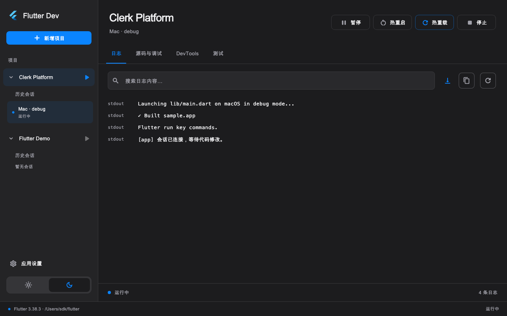

<div align="center">
  
  <h1>Flutter Dev</h1>
  <p>为 Flutter 开发打造的独立运行与调试工作台。</p>
  <p>
    <a href="#快速开始">快速开始</a> ·
    <a href="docs/usage.md">使用指南</a> ·
    <a href="#参与贡献">参与贡献</a> ·
    <a href="https://github.com/pillarxie/flutter_dev/issues">问题反馈</a>
  </p>
</div>

Flutter Dev 将项目管理、设备选择、运行调试、网络请求和 DevTools 集中在一个桌面应用中。你可以继续使用喜欢的编辑器编写代码，在工作台中启动应用、查看日志、执行热重载和分析性能。

基于 **Flutter + Rust** 构建，面向 macOS、Windows 和 Linux。


<details>
<summary>查看深色工作台</summary>



</details>

*截图使用样例会话展示界面。*

## 功能特色

- **项目与 SDK 管理**：识别仓库中的 Flutter 应用，恢复项目列表，支持 FVM、项目独立 SDK 和全局默认 SDK。
- **Git 分支切换**：识别项目所属仓库，在项目列表显示当前分支，通过项目标题下方的分支名切换本地分支，并可手动刷新。
- **运行与调试**：按项目保存草稿、上次启动和多套命名运行配置，启动或附加应用，支持应用及本地依赖 Dart 文件保存后自动热重载（系统监听、轮询兜底）、手动热重启和基础断点调试。
- **日志与源码**：搜索、复制和筛选错误日志，暂停跟随输出，点击堆栈源码位置使用已配置编辑器打开；保留只读源码和基础调试请求。
- **网络请求查看**：按方法与状态筛选请求，右键复制 cURL，搜索响应正文；JSON 支持逐节点及全部展开/收起，保留原始内容切换与复制，无需添加 Dio 拦截器。
- **DevTools 集成**：在工作台中打开 Inspector、Performance、CPU Profiler、Memory 和 Logging。
- **构建与打包**：通过预设执行 Flutter 构建，展示目标项目的 `version+build_number`；关闭窗口后继续后台运行，从左侧「构建任务」查看版本、进度、日志和结果，并打开产物目录。
- **测试运行**：发现项目测试文件，运行全部、单文件或已发现的单个测试，显示真实结果和错误，支持停止与失败重跑。
- **桌面体验**：浅色与深色主题、自适应窗口布局、常用操作快捷键，以及持久保存的应用偏好。

iOS 的 Debug / Profile 新启动会话使用独立 VM 端口和 Dart 输出流，避免同设备多个 `Runner` 项目的日志与调试连接混用。启动进度和工具错误保留；无法确认归属的设备原生 stdout 不展示。Release、附加会话及其他平台沿用原有日志路径，详见[日志说明](docs/usage.md#日志与编辑器)。

## 平台支持

项目处于早期开发阶段，目前以 macOS 为主要开发和验证平台。

| 桌面平台 | 当前状态 |
| --- | --- |
| macOS | 已完成本机运行、调试和内嵌 DevTools 验证 |
| Windows | 已提供桌面工程；内嵌 DevTools 使用 WebView2，待实机验证 |
| Linux | 已提供桌面工程，待实机验证；DevTools 暂通过外部浏览器打开 |

可运行或构建的目标取决于宿主系统、项目所选 Flutter SDK 和本机工具链。例如，iOS 构建需要 macOS 与 Xcode。

## 快速开始

### 环境准备

| 工具 | 版本 |
| --- | --- |
| Flutter | 3.38.3（当前开发基线，包含 Dart 3.10.1） |
| Rust | 1.95.0 或更高版本 |

还需安装对应桌面平台的工具链：

- **macOS**：Xcode、命令行工具和 CocoaPods。
- **Windows**：Visual Studio 的 C++ 桌面开发组件，以及 NuGet CLI；内嵌 DevTools 需要 WebView2 Runtime。
- **Linux**：Clang、CMake、Ninja、GTK 3 开发库及 liblzma 开发库。

使用分支功能还需安装 Git 并使其可从 PATH 调用。支持 `.git` 目录、worktree 的 `.git` 文件，以及仓库子目录中的项目；切换仅针对已有本地分支，未提交改动导致冲突时显示 Git 错误，不强制覆盖文件。

### 从源码运行

```sh
git clone https://github.com/pillarxie/flutter_dev.git
cd flutter_dev
flutter pub get
flutter run -d macos
```

在 Windows 或 Linux 上，将最后一行的 `macos` 替换为 `windows` 或 `linux`。Rust 核心会在 Flutter 构建过程中自动编译，无需单独启动服务。

### 开始使用

1. 点击「新增项目」，选择 Flutter 项目或包含多个应用的仓库。
2. 选择应用、设备、运行模式和入口，需要时在「高级设置」中指定 SDK 与启动参数。
3. 点击「启动会话」，通过会话页查看日志、热重载、调试和使用 DevTools。
4. 需要打包时，点击项目配置页的「构建」，选择预设并执行。构建窗口可以关闭，通过左侧「构建任务」重新进入详情。

完整操作说明、网络面板支持范围及常见行为见 [使用指南](docs/usage.md)。

### 构建桌面应用

在对应宿主系统上执行：

```sh
flutter build macos --release
# Windows: flutter build windows --release
# Linux:   flutter build linux --release
```

macOS 构建产物为 `build/macos/Build/Products/Release/Flutter Dev.app`。当前源码构建尚未完成正式发行签名与公证。

Windows x64 安装包由 [Windows package 工作流](.github/workflows/windows-package.yml) 生成。在 Actions 中手动运行该工作流，或推送 `codex/windows-package-*` 分支后，从成功运行的 Artifacts 下载 `FlutterDev-windows-x64-*`，解压后包含 `Setup.exe` 安装器、便携 ZIP 和 SHA256 校验文件。安装器安装到当前用户目录，附带 Rust 核心及 Visual C++ 运行库；内嵌 DevTools 仍需系统安装 WebView2 Runtime。安装包尚未进行代码签名，实际产物名称包含版本号。

在 Windows 本地已安装 Inno Setup 6 时，也可以执行：

```powershell
flutter pub get
flutter build windows --release
./scripts/package-windows.ps1
```

产物输出到 `build/windows/installer/`。便携版需解压完整目录后运行，不能只复制 `flutter_dev.exe`。

## 开发路线

接下来重点完善：

- 源码断点交互、调用栈和变量树。
- launch.json 配置导入。
- 测试覆盖率与设备集成测试任务。
- Windows / Linux 的实机兼容性与 Linux DevTools 内嵌。

目前的调试面板仍以基础协议请求为主；网络面板仅支持已连接 VM Service 的 Debug 会话中的 `dart:io` / `http_profile` HTTP 请求。更多平台与能力说明见 [兼容性说明](docs/compatibility-baseline.md)。

## 参与贡献

欢迎通过 [Issues](https://github.com/pillarxie/flutter_dev/issues) 反馈问题、提出想法，或提交 [Pull Request](https://github.com/pillarxie/flutter_dev/pulls) 改进功能与文档。

反馈问题时，请附上操作系统、Flutter / Rust 版本、复现步骤及相关日志。涉及较大功能或架构调整，建议先在 Issue 中讨论方案。

源码主要分为三部分：

| 目录 | 职责 |
| --- | --- |
| `lib/` | Flutter 工作台、界面组件与原生桥接适配 |
| `rust/` | SDK、协议、进程、会话、设置与构建管理 |
| `rust_builder/` | Rust 原生库的 Flutter 插件与构建接线 |

开发前请阅读 [开发指南](docs/development.md) 和 [AGENTS.md](AGENTS.md)，了解检查命令、桥接生成方式及项目约定。架构背景见 [技术设计](docs/technical-design.md)。

## 致谢

项目基于 Flutter、Rust、flutter_rust_bridge 和 cargokit 构建，并复用 Flutter SDK 提供的调试适配器与 DevTools。
